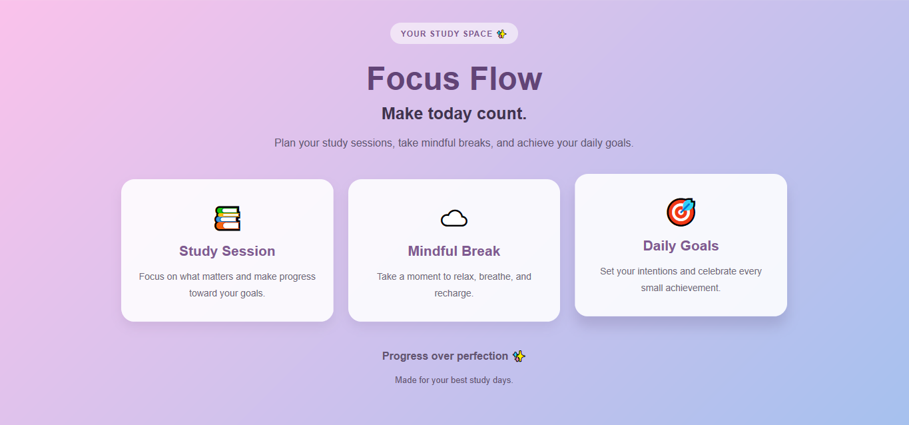

# ✨ Focus Flow — Study Planner

A clean, responsive study planner landing page built with HTML and CSS, designed to inspire focus, encourage mindful breaks, and help students stay motivated.

## 🌷 About the Project

Focus Flow is a beginner-friendly frontend project that combines a soft pastel gradient background, elegant typography, and rounded cards to create a calm and welcoming study space.

The page introduces three essential elements of a productive study routine: focused study sessions, mindful breaks, and daily goals.

This project was created to practice core HTML and CSS concepts while building a visually appealing and responsive web interface.

## ✨ Features

- 🎨 Soft pink-to-blue gradient background
- 📚 Three dedicated cards for study sessions, mindful breaks, and daily goals
- 💫 Smooth hover animations and subtle shadows
- 📱 Responsive layout for desktop, tablet, and mobile screens
- 🧩 Semantic HTML structure
- 🎯 Clean typography, rounded corners, and consistent spacing
- 🌐 Lightweight design with no JavaScript dependencies

## 🛠️ Built With

- **HTML5** — Page structure and semantic elements
- **CSS3** — Styling, gradients, transitions, shadows, Grid, and responsive media queries

## 📸 Preview

<!-- Add your project screenshot to the repository and update the path below. -->



## 🚀 Getting Started

Follow these steps to run the project locally.

### 1. Clone the repository

```bash
git clone https://github.com/Tara-Hassanzadeh/focus-flow-study-planner.git
```

### 2. Open the project folder

```bash
cd focus-flow-study-planner
```

### 3. Run the project

Open `index.html` in your browser.

No additional dependencies or installation steps are required.

## 📂 Project Structure

```text
focus-flow-study-planner/
├── index.html
├── style.css
├── README.md
└── screenshot.png
```

## 📚 What I Learned

While building this project, I practiced:

- Structuring a webpage with semantic HTML
- Styling elements using CSS selectors and classes
- Creating gradient backgrounds and card-based layouts
- Using CSS Grid to arrange content
- Adding hover effects with CSS transitions
- Making layouts responsive with media queries
- Improving visual hierarchy through typography, spacing, and color

## 🔮 Future Improvements

Possible future enhancements include:

- Adding an interactive study timer
- Allowing users to create and track daily goals
- Saving study progress
- Improving accessibility and adding more customization options

These features are ideas for future development and are not currently implemented.

## 👩‍💻 Author

**Tara Hassanzadeh **

Computer Engineering Student | Aspiring Frontend Developer

- GitHub: [@tara-hassanzadeh](https://github.com/tara-hassanzadeh)

---

*Progress over perfection ✨*
